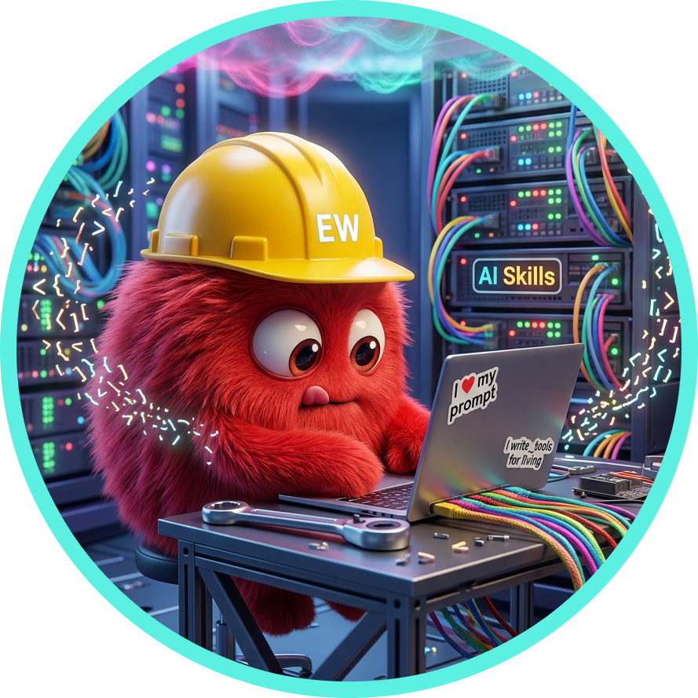

<!-- prettier-ignore -->
<div align="center">

# EW Extensions

[](https://github.com/ai-ecoverse/vibe-coded-badge-action)



[](https://github.com/exp-workspace/ew-extensions/actions)
[](https://nodejs.org)
[](https://www.openjs.org)
[](LICENSE)

[Overview](#overview) | [Extensions](#extensions) | [Architecture](#architecture) | [Local development](#local-development) | [Adding an extension](#adding-an-extension)

</div>

## Overview

This repository hosts **extensions** for the Experience Workspace (EW). Each extension is a self-contained [DA App SDK](https://docs.da.live/developers/guides/developing-apps-and-plugins) application deployed on its own AEM Edge Delivery Services site and loaded into the EW shell.

Extensions add capabilities to EW — editors, panels, tools, and integrations — without modifying the core platform.

## Extensions

| Extension | Path | Entry point | Description |
|-----------|------|-------------|-------------|
| **Skills Editor** | `apps/skills/` | `tools/skills.html` | Manage skills, agents, MCP servers, prompts, and memory |
| **[Brand Visibility](tools/brand-visibility/README.md)** | `tools/brand-visibility/` | `tools/brand-visibility/brand-visibility.html` | Review LLMO opportunities and page-specific suggestions |
| **Proposed Changes** | `tools/proposal-review/` | `tools/proposal-review/proposal-review.html` | Review accessible staged HTML pages in the current site, view diffs, and discard or apply drafts |

> More extensions coming soon.

### Proposed Changes

Register `/tools/proposal-review/proposal-review.html` as an EW extension URL.
It uses the DA SDK's authenticated fetch and current org/site context; no token
or site parameters are required. The panel lists accessible HTML files recursively
under the site's `/.da/proposals/` folder, including paginated listings, and checks each
page's read access before displaying it. It does not filter
by author: this staging location is shared and the listing API has no ownership
field. Other `.da` content, including HTML drafts outside `/.da/proposals/`, is
not listed or changed. Drafts preserve the original's path below the site:
`/<org>/<site>/.da/proposals/campaigns/page.html` maps back to
`/<org>/<site>/campaigns/page.html`. Drafts in the old `/.da/<path>.html`
location are not migrated or included.

On hosts advertising `chatTurnCompleted` support, the extension uses the DA
SDK's `subscribeChatTurnCompleted` action to refresh when a chat turn finishes,
including aborted or failed turns. Refreshes wait until an open
confirmation or apply/discard operation finishes, and notifications received
while busy are coalesced. Subscriptions are removed when the extension
disconnects. Manual Refresh remains available on older hosts.

View diff calls the SDK's `openComparison` action with the full draft path as
`candidate` and the derived original path as `baseline`. Experience Workspace
loads and displays both saved DA sources in its host comparison surface; the
extension no longer renders a dialog, iframe, or full-source comparison.
Unsaved editor changes are not included. The host owns loading, sanitization,
refresh, close, and source-read errors. There is no comparison acknowledgement,
so both the SDK and host must support source-path operands.

The extension's `?nx=<branch>` option selects the SDK branch using the same NX
origin rules as the Skills Editor; `?nx=local` uses `http://localhost:6456`.
Without an override it uses the production SDK at `https://da.live`. Until the
source-path SDK is deployed, configure the local extension as:

```text
http://localhost:3000/tools/proposal-review/proposal-review.html?nx=a2uidiff
```

Use the matching `a2uidiff` da-live host as well; the extension's `nx` parameter
selects only its SDK, not the host. An older SDK reports an actionable error
instead of falling back to an inline diff.

The extension checks configured Coworker skills directly using the SDK's
authenticated fetch, IMS account context, merged org/site flags, and Coworker
manifest. It supports AO and entitled CMA accounts. If `page-proposals` is
missing, **Add personal skill** sends `add this personal skill` followed by the
bundled skill to chat using the existing `setPrompt` action. Nothing is sent
automatically, and a sent request is not treated as an installed skill.
Manual refresh and chat-turn completion recheck the catalog. Lookup failures
offer a retry without blocking page review or claiming the skill is missing.
Host-only chat query overrides are not visible to the iframe; if using
`nx-chat-ao` or `nx-chat-ao-manifest`, repeat them on the extension URL.

Discard deletes only the staged file. Apply saves the complete
draft over its original, then deletes the draft and verifies its removal.
Apply is an unconditional overwrite: it does not require an ETag or send
`If-Match`, and can overwrite source changes saved after the proposal or diff.
Both original and draft must exist. Nothing is previewed or published.

Actions require confirmation. Apply all is sequential and stops on failure.
Failed saves retain drafts; failed cleanup can be retried without saving again
while the panel remains loaded. Cleanup state is in-memory, not persisted across
reloads. A draft changed during apply is retained. DA's delete endpoint has no
conditional-delete support, so concurrent draft edits during the final
read/delete window cannot be protected atomically. Avoid editing drafts while
applying or discarding them.

## Architecture

Every extension follows the same pattern:

1. **Block contract** — each extension exports a `decorate(block)` function, loaded by da-nx's `loadBlock` via `providers.ew` routing (triggered by the `ew-` class prefix).
2. **EW hosts the extension** at `da.live/apps/{extension}#/{org}/{site}`. The page contains a `<div class="ew-{extension}">` that `loadBlock` resolves to this repo.
3. **Extension component** — a LitElement (or vanilla JS module) that owns its own UI, state, and data operations against the DA Admin API.

## Local development

To develop locally, run three servers:

```bash
# 1. da-live (port 3000)
cd ~/Projects/DA/da-live && aem up

# 2. da-nx (port 6456)
cd ~/Projects/DA/da-nx && npm run local

# 3. ew-extensions (port 3001)
cd ~/Projects/DA/da-skills && aem up --port 3001
```

Then navigate to:

```
http://localhost:3000/apps/skills?nx=local&nxver=2#/{org}/{site}
```

The `?nx=local&nxver=2` params tell da-live to load da-nx from localhost, which in turn resolves `ew-*` blocks to `:3001`.

For isolated extension development (no auth, no da-nx routing):

```
http://localhost:3001/apps/skills/skills.html
```

## Adding an extension

1. Create a new directory under `apps/{your-extension}/`.
2. Add an entry point at `tools/{your-extension}.html` that imports the DA App SDK.
3. Implement your extension component — see `apps/skills/` for a reference implementation.
4. Update the extensions table above.

## Authentication

The DA App SDK handles authentication for all extensions. When EW loads an extension in an iframe, the SDK passes the user's IMS access token via PostMessage. Extensions call `initAuth(token)` to configure subsequent DA Admin API requests.

No separate login flow is needed — the user is already authenticated in EW.

## CI

Linting (ESLint + Stylelint) runs on every push that touches `apps/`. E2e tests (Playwright) are available locally — see `test/e2e/README.md` for the tiered test strategy.
