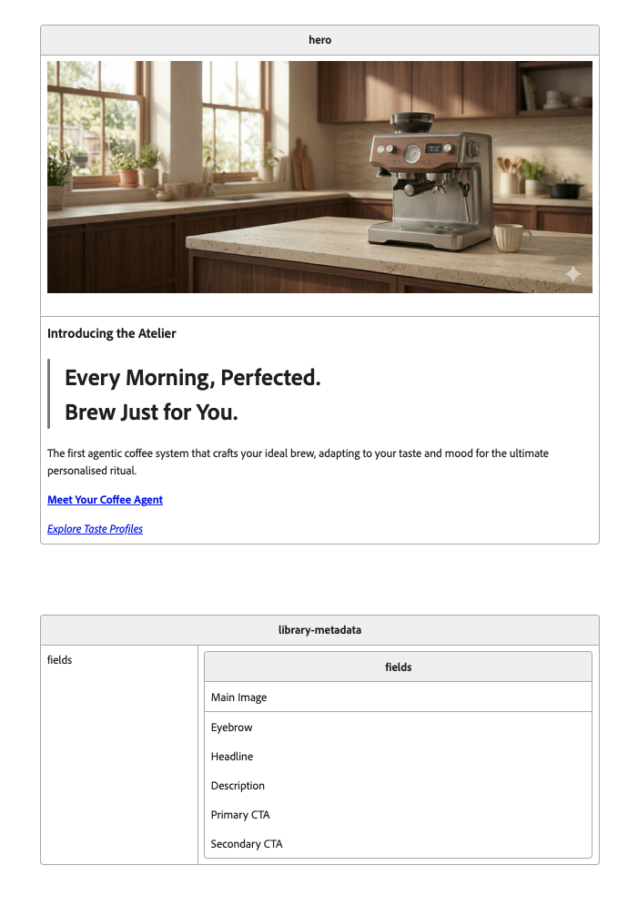

# Block editor extension

Edit a canvas block through a properties sidebar instead of changing its content
directly on the page. The extension follows the block containing your caret and
shows its configured fields, variant, images, and repeating items.

Changes update the live canvas, including unsaved content, and use the editor's
normal undo/redo, collaboration, and autosave. Field labels come from your block
library, so authors see names such as **Title**, **Image**, and **Link** rather than
the underlying block structure.

## Installation

Add the following URL as a sidebar extension in the `library` sheet of your
organization or site configuration:

`https://blockimg--ew-extensions--adobe-rnd.aem.live/tools/block-editor/block-editor.html`

## Configs

Blocks must be part of the site's configured **Blocks** library. The extension
matches the selected block's name and variant to a library template, then uses
that template's `fields` metadata to label the sidebar controls.

Configure each variant separately, including the version without a variant.
Field definitions belong in the **library template document**, not in each page
that uses the block. Existing page content must have a compatible structure for
those fields to be editable.

### Using AI

The easiest way to create field definitions is the **Generate fields** button:

1. Place the caret inside the block you want to configure.
2. Click **Generate fields** when the sidebar has no field definitions. This sends
   a request to the host's AI assistant with the selected block, variant, and
   library sources.
3. Review the assistant's proposed changes to the matching library document.
   The fields should describe the library template, not extra content added to
   the current page. Keep the template content and other metadata intact.
4. Save the library changes and click **Refresh** in the sidebar to reload them.
5. Repeat for every variant you want to support.

If existing metadata is invalid, the sidebar offers **Repair fields** instead.
Review the repair and refresh the library in the same way. AI generation requires
a host that supports sending prompts to its assistant; it does not generate
fields locally in the sidebar.

### Manually

In the library document, add a `fields` property to the block variant's
**Library Metadata** table. Its value must be a nested table with:

- A first row containing a single cell titled **Fields**, spanning the table's
  columns.
- Content rows that mirror the library block's content rows, with the same cell
  order and spans. Do not copy the block name/variant header as a content row.
- One paragraph per field label inside each cell, in the same order as the
  content it describes. Multiple fields in one cell need multiple paragraphs,
  not additional table rows.

For example, here's a hero block configuration:

Count each heading, paragraph, image/picture, or whole list as one field.
Inline formatting and links do not need additional labels. For blockquotes,
label the text blocks inside the quote rather than the wrapper. Empty spacer
paragraphs around image-only content do not need labels.

Use **IGNORE** as a label to hide a field while keeping its position. For example,
in a key/value row containing `Color` and `Green`, label the key cell `IGNORE`
and the value cell `Color`. Do not remove the hidden field's position from the
metadata, or later labels will no longer match the template.

### Repeating items

For blocks such as Cards where each content row is a repeating item, add an entry
to the block library index's `editor` sheet:

| block | property |
| --- | --- |
| cards | multi |

Use the block's base name, without its variant. Repetition is determined by this
configuration, not by the block name or by similar-looking rows.

For a `multi` block, the fields table must contain **exactly two rows**: the
**Fields** header and one row describing the first item's cells and fields.
Every item reuses that schema, even if the library template contains several
sample items. The first item also supplies the template for adding new items.

Without `multi` configuration, field metadata must describe **all** content rows
in the library template. A list inside a cell is still one field; it is not the
same as a repeating block item.

### Dropdown options

For simple key/value rows, you can provide predefined choices through the block
library index's `options` sheet:

| blocks | key | values |
| --- | --- | --- |
| hero | Color | Green=green\|Blue=blue\|Purple=purple |

`blocks` is a comma-separated list of block names, or `all` for shared options.
`key` matches the key in the block's key/value row. Separate choices with `|`;
`Label=value` provides a display label and a stored value. If `=value` is omitted,
the label itself is stored. These options are separate from the field labels in
Library Metadata.

## Using the sidebar

Place the caret anywhere inside a block; selecting text is unnecessary. Moving
to another block updates the sidebar, and moving outside all blocks clears it.

| Task | How |
| --- | --- |
| Edit text or links | Change the field and move focus away to apply it. Simple links expose their text and destination. |
| Change a configured value | Select an option from its dropdown. |
| Change the variant | Use **Variant** to apply a variant available in the library. This changes the block's variant classes, not its content template. |
| Replace the block | Click the block name to open the canvas's existing **Blocks** library and choose a replacement template. |
| Edit repeating items | Expand an item to show its fields. Use **Add item** or its delete button to change the item count. |
| Reorder repeating items | Drag an item by its header, or focus the item and press **Alt+ArrowUp** / **Alt+ArrowDown**. |
| Edit lists | Change individual items, or use the list controls to add, delete, and reorder them. |
| Replace an image | Click **Replace image** and choose a PNG, JPEG, GIF, or SVG file up to 20 MB. |

Image uploads are stored with a unique filename in the document's media folder,
so replacing an image does not overwrite an asset used elsewhere. Existing alt
text and enclosing links are preserved. AEM Assets browsing is not supported.

There is no separate sidebar save step. Changes enter the live editor and follow
its normal autosave; a successful sidebar update is not a separate confirmation
that durable saving has finished.

## Troubleshooting and limitations

| Symptom | What to check |
| --- | --- |
| No fields appear | Place the caret inside a block, check that its exact variant is in the Blocks library, and add its fields metadata. |
| **Generate fields** or **Repair fields** appears | The selected template has missing or invalid field metadata. Generate or repair it, save the library document, then click **Refresh**. |
| A field does not match the selected block structure | Compare the page block with its library template and check the metadata's row, cell, and field counts. Incompatible fields are not editable. |
| A field is read-only | Check document permissions and content structure. Complex rich/nested markup, mixed text/image fields, and fields with multiple images are not editable through the sidebar. |
| A library template cannot load | Check its library entry and document availability, then click **Retry loading library**. Other successfully loaded templates remain usable. |
| An edit conflicts with a canvas update | Review the latest canvas content. **Discard drafts** clears pending text edits and returns to the latest live values without reloading the document. |

Edits are checked against the captured document and selected block before being
applied. If the selection moves or the document changes while you are editing,
the extension rejects the stale operation rather than overwriting newer content.
Failed updates are not automatically retried.

Avoid switching blocks while an image upload is in progress. If the document or
selection changes, the image replacement is rejected; an already-uploaded file
may remain unused in the media folder.
